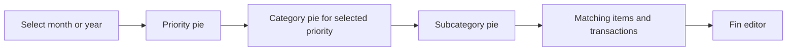

# Spending Priority

## Overview

Status: Implemented on `codex/spending-priority`. The local database migration is applied.

Date: 2026-11-03.

Last updated: 2026-11-07. Receipt tax and tips initially copy the record priority, then remain independent.

Classify expenses as Essential, Personal priority, Optional, or Unexpected. Support record defaults, item overrides, receipt AI suggestions, and monthly or yearly reports.

## Design Decisions

### Definitions and rule order

| Stored value | English label | Chinese label | Definition |
|---|---|---|---|
| `essential` | Essential | 必需 | Protect spending for basic living, health, or obligations. |
| `personal_priority` | Personal priority | 品质 | Choose to protect spending for wellbeing, confidence, or personal goals. |
| `flexible` | Optional | 可选 | Comfortably reduce, delay, or skip this spending. |
| `unexpected` | Unexpected | 突发 | Track unplanned charges such as fines, penalties, and repairs after a breakdown. |

Apply these rules during receipt preclassification:

1. Initialize purchase-tax items from the record priority. Classify standalone tax payments and services by their purpose and obligations.
2. Initialize identified tips and gratuities from the record priority, then save them as independent item values.
3. Assign explicit fines and penalties to Unexpected. Suggest Unexpected for repairs only when the receipt shows unplanned damage or a breakdown.
4. Use the receipt AI's suggested priority for other items.
5. Use the record default for other items without an explicit priority.
6. Default new records to Essential.

Necessary medicine usually suggests Essential. Aesthetic care usually suggests Personal priority. Discretionary extras usually suggest Optional.

Unexpected identifies costs the user wants to track as unplanned. Routine maintenance follows the normal priority rules.

Personal context can change item suggestions. Tax and tip charges use the record priority as their initial value.
Purchase tax and tips initially copy the record priority, including on mixed-priority receipts. Do not split these charges across priorities.
For example, tax and tips on a Personal priority record initially use Personal priority.
Save each charge priority explicitly. Later changes to tax, tip, or record priority do not change the others.

Store tax and tip amounts as separate fin items with explicit priorities.
A null tax or tip suggestion requests the current record priority as its initial value, rather than persistent inheritance.
Do not add an item-kind field.

Users can correct any item's priority before saving or during later edits. Reports use saved priorities without interpreting item names again.

Income does not participate in priority reports.

### Record defaults and item overrides

The record stores a default priority. An item with a null priority inherits that default.

An explicit item priority remains independent from the default. Preserve explicit Essential overrides even when they equal the current default.

Changing the default updates inherited items only. A null item priority means inheritance, rather than an unclassified fourth level.

The record panel uses the shared dropdown directly beside the currency selector.
Show only the selected default level. Omit description and summary lines from the record panel.

The item panel uses the shared dropdown beside brand, without labels or explanatory text.
The item dropdown shows only the four levels. Items without an override display their inherited effective level.
Selecting a level saves an explicit override. Product name, amount, and member share the first row.
Product suggestions span that row while the name input keeps its original width.

### Editable necessity reason

Provide an optional Reason / 原因 field on each item in receipt review and item editing.

Keep the reason input folded by default, including when an AI or saved reason exists.
Show a notebook button beside the priority dropdown. A small dot indicates an existing reason.
Clicking the button opens the input below priority and brand and focuses it.
Users can write, edit, or clear the reason before saving. Folding the input preserves its value.

Store the saved reason and show it when the user opens the input. A blank reason saves as null.
AI reasons are optional. Request them only for key items with useful receipt context.
Do not generate explanations that only repeat the priority definition, including routine tax or tip explanations.

Changing the item's priority clears its previous reason in the draft. Users can enter a replacement before saving.

When an inherited item's effective priority changes, clear its previous reason to prevent an outdated explanation.

Do not require a reason for any level. Reasons do not affect classification or reporting totals.

### Category scope

Keep the existing category and subcategory model for this feature.

Use an item's existing category pair when its category exists. Otherwise, use the record's category pair.

Resolve the pair together. Never combine an item category with a record subcategory. Group missing values under Uncategorized.

Category editing, category identifiers, and category split rows are outside this implementation.

### Database changes

Add three columns across the existing tables. No new table is required.

| Table | Column | Type and default | Purpose |
|---|---|---|---|
| `fin` | `necessity_level` | Non-null text, default `essential` | Record default and priority for records without items. |
| `fin_items` | `necessity_level` | Nullable text, default null | Explicit item override. Null means inheritance. |
| `fin_items` | `necessity_reason` | Nullable text | Optional, editable explanation from receipt AI or the user. |

Constrain priority values to `essential`, `personal_priority`, `flexible`, and `unexpected`. Allow null only on item overrides.

Use real SQLite check constraints in the migration. Verify that generated Drizzle declarations produce equivalent constraints.

### Existing data

Existing records receive Essential through the migration default. Existing items inherit the record default.

Recognize legacy tax rows only through the exact signature produced by the current receipt importer.

Report candidate legacy tip rows in a dry run. Require a verified mapping before changing their priority.

Do not send historical receipts to AI during migration. Historical defaults represent an initial assignment, rather than reviewed classifications.

## Implementation Details

### Validation results

1. The focused priority suite passes, including migration, mutation APIs, scheduling, receipt normalization, and reports exceeding 1,000 items.
2. Existing product-photo regression tests pass against the migrated schema.
3. TypeScript and the production build pass.
4. New feature files pass ESLint. Repository-wide lint still reports existing errors in unrelated components.
5. Browser verification covers monthly and yearly charts, every drill-down level, editable reasons, save and refresh, and mobile horizontal overflow.
6. Receipt normalization tests use model-shaped fixtures. Live receipt AI calls were not run.
7. Docker is unavailable locally. The migration scripts pass against disposable SQLite databases without a container build.
8. Constraint expansion tests preserve records, references, indexes, triggers, and views. A failed replacement rolls back both tables.

### Migration result

The local database received a SQLite backup before migration.
The migration assigned explicit Essential levels to 316 exact legacy tax rows.
That historical migration predates the revised tax rule. This receipt change does not reclassify saved tax overrides.
It reported 26 legacy tip candidates for review and preserved their inherited defaults.

### Current implementation findings

| Area | Current behavior | Required change |
|---|---|---|
| Schema | Records and items already contain category fields. | Add record and item priority fields and an editable item reason. |
| Receipt analysis | Gemini extracts products. The server appends a tax row. | Extract tips and item suggestions. Normalize taxes and tips explicitly. |
| Receipt review | Several types and mapping functions describe analyzed items. | Share types and preserve new fields through every mapping. |
| Fin updates | Item updates delete and recreate rows. | Preserve every priority field during replacement. |
| Scheduled records | Creation and scoped updates copy items. | Copy priority fields through every occurrence path. |
| Category charts | Selectors aggregate record totals. | Add a separate priority report based on item allocations. |
| Item API | Requests return at most 1,000 items. | Aggregate the complete report period on the server. |
| Docker | Startup runs the product-photo migration script. | Run the priority migration before the application starts. |

### Phase 1: Shared model and migration

1. Add shared priority definitions, labels, explanations, and the effective-priority resolver.
2. Define the shared `NecessityLevel` type.
3. Add the three columns and constraints to the Drizzle schema and a new migration.
4. Add a migration runner with dry-run output and repeatable execution.
5. Check existing columns before altering tables.
6. Apply schema changes and verified legacy tax updates in one database transaction.
7. Add the migration command to `package.json`.
8. Package the runner and run it before Next.js starts in Docker.

The migration is `drizzle/0005_add_fin_necessity.sql`. The runner applies missing columns in an immediate transaction.
The constraint helper expands existing priority checks to accept Unexpected while preserving records, indexes, triggers, and references.
The standalone `drizzle/manual-add-fin-necessity.sql` supports manual SQLite execution before priority columns exist.
It adds all fields and four-level constraints in one transaction. Use the repeatable runner for databases already containing priority columns.

Use `DATABASE_PATH` for local and Docker migrations. Back up the SQLite database through its backup API before deployment.

Do not copy a live WAL database as a standalone file. Test the migration on a disposable backup first.

Completion condition: existing data remains intact, defaults resolve correctly, and a second migration run makes no changes.

### Phase 2: API contracts and persistence

1. Extend create, update, detail, list, item, and receipt-analysis response types.
2. Add record `necessityLevel` and item `necessityLevel` and `necessityReason` fields.
3. Validate enum values, null semantics, reason length, and integer item amounts.
4. Persist explicit tax and tip priorities initialized from the record. Preserve later manual corrections.
5. Preserve the record default when an update omits `necessityLevel`.
6. Interpret an explicit null item priority as Use record default.
7. Preserve items when an update omits `lineItems`. Delete them only when the update explicitly supplies an empty array.
8. Carry every new item field through single-record updates and scheduled creation or updates.
9. Keep record and item writes inside the existing database transaction.

Set a 300-character limit for stored reasons. Treat reasons as plain text. Normalize blank reasons to null.

Clear reasons on inherited items when their record default changes. Apply this rule within the selected schedule scope.

Legacy requests that omit new fields create Essential defaults and inherited items.

Do not match replacement items by their array position to recover omitted overrides. The current API replaces the supplied item collection.

Update the current client to send complete item classifications whenever it replaces items.

Completion condition: classifications survive create, save, reload, and scoped schedule edits through JSON and multipart requests.

### Phase 3: Receipt AI suggestions

1. Add the definitions, examples, and tax or tip precedence rules to the vision prompt.
2. Request `suggestedNecessityLevel` for each extracted item. Request an optional `necessityReason` only when useful receipt context explains a key item.
3. Extract a separate `tipAmount` when the receipt identifies a tip.
4. Keep product extraction separate from generated tax and tip rows to prevent duplicate charges.
5. Append exactly one tax row and one tip row when their separate amounts exist.
6. Validate AI values before showing suggestions.
7. Use Essential when an ordinary product suggestion is missing, invalid, or uncertain.
8. Set purchase-tax and paid-tip suggestions to null to request initial record priority. Receipt review resolves and saves each explicit value.
9. Preserve priority metadata through item-name standardization by matching the original item index.
10. Show editable suggestions and optional editable reasons in receipt review before saving.

When separate amounts are absent, retain individually extracted tax or tip rows. Never invent missing amounts.

Distinguish a suggested tip table from a tip actually paid. Do not classify a generic service fee as a tip without evidence.

Classification failures must not discard successfully extracted items. Name-standardization failures must preserve original names and priority metadata.

Use the existing receipt-analysis request. No additional model request or provider is required.

Confirming receipt review transfers suggestions into the editor. Cancelling review discards the proposed item changes.

Reanalysis requires confirmation before replacing existing items and their manual classifications.

Completion condition: tax and tips start with the record priority, and later edits to any of these values remain independent.

### Phase 4: Record editor and item editor

1. Use the shared record default dropdown beside the currency selector, without description or summary lines.
2. Show only the four levels in each item selector. Display the inherited effective level until users select an override.
3. Display each inherited item's effective level as its selected value, without an additional inheritance option.
4. Show tax and tip as separate items. Initialize both from the record priority and save explicit values.
5. Allow users to correct any item's priority.
6. Add an optional editable reason during receipt review and item editing.
7. Clear the previous reason when the item's explicit or inherited priority changes.
8. Add priority fields to dirty-state detection and preserve the existing cancellation behavior.
9. Keep the record panel compact and show the selected default level in its dropdown.
10. Hide expense-priority controls for income records.

Use existing UI kit components and relative imports. Verify mobile layouts and dark mode.

A default-only scheduled update must omit unchanged `lineItems`. It must preserve each occurrence's independent explicit overrides.

An explicit scheduled item replacement follows the existing single or all-future scope. Earlier occurrences remain intact.

Completion condition: users can classify mixed purchases without editing categories or losing existing item data.

### Phase 5: Reporting allocation and API

Create one pure allocation function for all views in the new report.

Each allocation contains its record identifier, optional item identifier, effective priority, resolved category pair, and allocated integer cents.

Apply these rules:

1. Exclude income records.
2. For a record without positive item amounts, allocate its paid amount to its record default and category pair.
3. For matching item and record totals, allocate each item's amount to its effective priority and category pair.
4. For a positive remainder, create a reporting allocation using the record default and category pair.
5. Label the remainder explicitly. Do not save it as a product item.
6. Resolve saved tax and tip priorities like other items. Receipt tax and tips save explicit initial values.
7. Preserve original item amounts, quantities, and unit prices.
8. Allocate stored CAD totals across original-currency allocations with deterministic largest-remainder rounding.
9. Break rounding ties by line number and item identifier.

The first dashboard uses CAD, consistent with the existing category charts. Do not add mixed-currency sums or fetch current exchange rates.

Allow item sums above the paid total during creation and editing. Preserve the supplied item amounts.

For all over-total records, proportionally scale reporting allocations to the paid total and mark them as estimates.

This refines the earlier whole-record fallback proposal. It preserves saved priority labels while preventing inflated totals.

Display the estimated amount and affected record count. Let users open those records for correction.

The allocation invariant is:

```text
Essential + Personal priority + Optional + Unexpected = selected expense total
```

Create an authenticated `GET /api/fin/necessity` endpoint for the selected period.

Accept a validated `period` of `month` or `year`, with a matching `YYYY-MM` or `YYYY` value.

Use UTC calendar boundaries, consistent with existing category-chart grouping. Use an inclusive start and exclusive next-period boundary.

Reject future periods. For the current period, include records through the current time rather than future scheduled occurrences.

Return the period total, priority totals, complete category and subcategory aggregates, estimated totals, and remainder totals.

Read all matching expense records and items through bounded database batches. Maintain per-record grouping across batch boundaries.

Scope every query to the authenticated user. Do not base aggregates on a paginated client item response.

Add paginated detail retrieval using the same allocation function and selected priority or category filters.

Return each transaction once, including its matched allocation amount and full paid amount.

Completion condition: monthly and yearly aggregates reconcile, including periods containing more than 1,000 items.

### Phase 6: Dashboard and navigation

Add a Spending priority view inside the existing Charts sheet. Reuse Recharts and the month or year controls.

Use `text-xs` for dashboard content, totals, legend buttons, transaction details, and status messages.
Tooltips also use 12px text. Use semibold weight for summary amounts and emphasized headings, matching existing chart views.



1. Show the selected expense total and amounts for all four priorities.
2. Use stable colors for Essential, Personal priority, Optional, and Unexpected.
3. Show amounts and percentages through visible labels and tooltips.
4. Support chart selection through both segments and keyboard-accessible legend buttons.
5. Preserve the selected priority while navigating category and subcategory views.
6. Add a breadcrumb for returning to any parent view.
7. Calculate percentages against the current chart total.
8. Reset drill-down selections when the period changes.
9. Show loading, empty, error, and reconciliation states.
10. Refresh the report after record creation, update, or deletion.
11. Prevent an older request from replacing results for a newer period.

Keep report data separate from the existing capped person-item collection and history filters.

Completion condition: users can navigate priority, category, subcategory, and transaction details with consistent totals.

### Phase 7: Verification and release preparation

| Verification | Required cases |
|---|---|
| Migration | Existing database, repeat execution, rollback on failure, foreign keys, exact legacy tax signature. |
| Priority rules | Default Essential, inheritance, explicit overrides, separate tax and tip items, preserved manual corrections. |
| API | JSON and multipart round trips, invalid values, omitted fields, null overrides, explicit empty item arrays, user isolation. |
| Scheduling | Single occurrence, all-future scope, copied item fields, preserved earlier occurrences, default-only edits. |
| Receipt processing | Mixed purchases, separate tax and tip, duplicate prevention, suggested tips, malformed AI values, metadata preservation. |
| Editor | Save and reload, cancel, reanalysis confirmation, editable reasons, blank reasons, stale reason clearing, inherited labels, mobile layout, dark mode. |
| Allocation | Exact totals, positive remainders, legacy over-total estimates, zero amounts, tax and tip isolation, FX rounding. |
| Reports | More than 1,000 items, records without items, month and year boundaries, income exclusion, future exclusion. |
| Navigation | Every drill-down level, uncategorized allocations, breadcrumb, period changes, stale requests, refresh after edits. |

Use the existing `tsx --test` approach for focused rule, allocation, migration, and API tests.

Use mocked model output to test receipt normalization. Live AI calls are not required for automated verification.

Run the existing photo tests because mutations share the photo transaction path. Run `yarn lint` and `yarn build`.

Use Node from `.nvmrc` and Yarn 4.5.3. Perform a Docker startup migration check against a disposable database.

Before preparing a PR, run the repository changelog workflow and bump the minor version.

### Implementation files

| Area | Updated files | Added files |
|---|---|---|
| Database | `app/lib/db/schema.ts`, `package.json`, `Dockerfile` | Migration SQL, `scripts/migrate-fin-necessity.mjs`, and `scripts/necessity-constraints.mjs` |
| Shared model | `app/lib/types/api.ts` | `app/lib/types/necessity.ts`, `app/lib/utils/necessity.ts` |
| Writes and reads | `app/api/fin/create/route.ts`, `app/api/fin/update/route.ts`, detail and list routes | Shared validation and normalization helpers |
| Receipt analysis | `app/api/receipts/analyze/route.ts` | Shared receipt types and testable response normalization |
| Editors | `FinEditorForm.tsx`, `LineItemEditor.tsx`, `LineItemsDialog.tsx`, `ReceiptAnalysisDialog.tsx` | Reuse the shared `Dropdown` component for priority selection. |
| Reporting | `ChartsView.tsx`, `app/lib/redux/features/fin/finSlice.ts` | Allocation helper, report API, priority pie, breadcrumb, and detail components |
| Validation | Existing photo tests and package scripts | Focused priority, migration, receipt, API, and report tests |

Place new dashboard components under `app/components/dashboard/charts/` or the existing dashboard feature folder.

### Updated documentation

The implementation updates the affected sections in these documents:

1. `docs/database-setup.md`: columns, defaults, constraints, and migration command.
2. `docs/api-implementation-fin-create-update.md`: request fields, validation, null semantics, and schedule behavior.
3. `docs/receipt-analysis-ai-implementation.md`: actual receipt pipeline, priority prompt, tax normalization, and tip extraction.
4. `docs/item-name-standardization-feature.md`: preserved priority metadata.
5. `docs/fin-editor-feature.md`: record default, item overrides, editable reasons, and separate tax or tip items.
6. `docs/charts-analytics-feature.md`: report API, allocation rules, period boundaries, and pie navigation.
7. `docs/docker-deployment.md`: migration startup order, backup, and deployment steps.
8. This document: completed phases and any revised decisions.

## Known Limitations / Future Work

1. Existing records initially reflect the Essential default. They require user review for more meaningful historical comparisons.
2. Legacy tip rows require verified identification before automatic migration.
3. Receipt AI cannot infer personal priorities reliably from every receipt. Users can edit item suggestions and reasons.
4. Historical over-total records use labelled allocation estimates until users reconcile them.
5. The first dashboard reports CAD. Additional display currencies can reuse the allocation approach later.
6. Priority history filters, bulk historical classification, category restructuring, and separate urgency flags are outside this version.
7. Existing item replacement changes item identifiers. Durable classification audit history would require a separate design.
